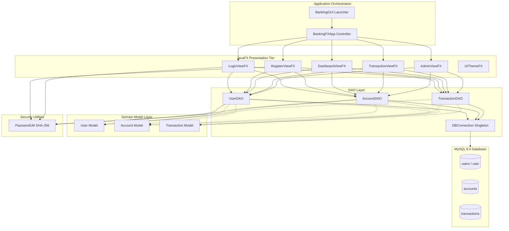
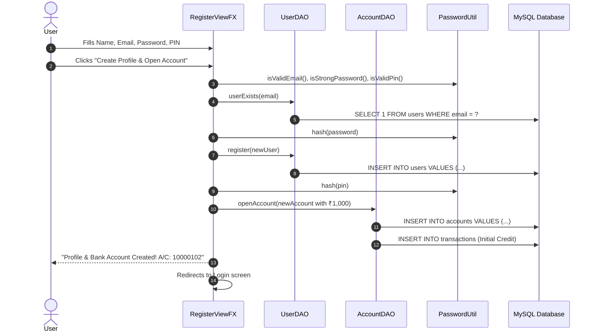
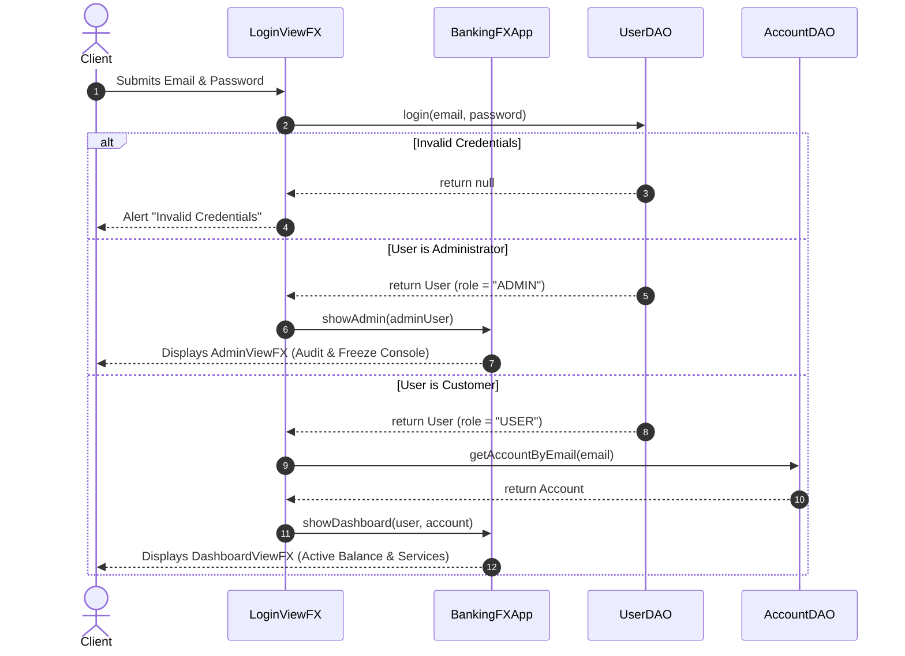
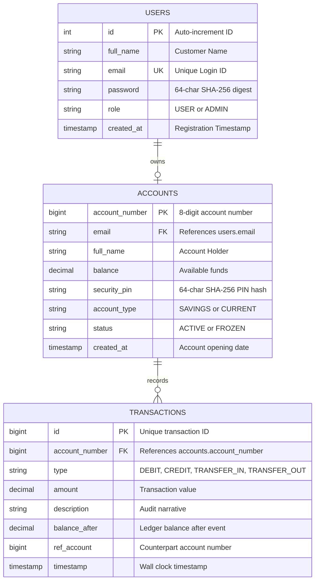

# 🏦 Apex Digital Banking System

[](https://www.oracle.com/java/)
[](https://openjfx.io/)
[](https://www.mysql.com/)
[](https://en.wikipedia.org/wiki/SHA-2)
[-gold?style=for-the-badge)](https://openjfx.io/)
[](https://en.wikipedia.org/wiki/Data_access_object)

An enterprise-grade, desktop Digital Banking Application built in Java strictly adhering to Object-Oriented Programming (OOP) paradigms, Layered Architecture (Model-DAO-UI-Util), and ACID Transaction Principles.

Engineered to satisfy the **Outstanding (Max. 15 Marks)** tier of the university evaluation rubric:
> *"Project with Event Handling, JavaFX, and Oracle/Mysql database with rich operations"*

Includes both a modern **JavaFX Graphical User Interface (GUI)** with event handling as well as a fully synchronized **Command-Line Interface (CLI)** sharing the exact same DAO layer, database, and cryptographic security.

---

## 📑 Table of Contents
1. [System Architecture](#-system-architecture)
2. [Key Features (14 Operations)](#-key-features)
3. [Process & Sequence Workflows](#-process--sequence-workflows)
4. [Database Relational Schema](#-database-relational-schema)
5. [Project Structure](#-project-structure)
6. [OOP & Design Patterns](#-oop--design-patterns-demonstrated)
7. [Installation & 1-Click Execution](#-installation--1-click-execution)
8. [Evaluation Credentials](#-evaluation-credentials)
9. [Viva & Evaluator Q&A](#-viva--evaluator-qa-guide)
10. [Detailed Code Documentation](#-detailed-code-documentation)

---

## 🏛️ System Architecture

The application implements a strict **4-Tier MVC / DAO Architecture**. Domain models, database operations, presentation cards, and cryptographic utilities are isolated into decoupled packages:



---

## ✨ Key Features

### 👤 Customer Banking Portal
1. **Instant Registration & Account Provisioning**: Sign up captures user details and Security PIN, creating the login profile and opening an active bank account with ₹1,000 opening credit in one atomic step.
2. **Cryptographic Security**: Passwords and 4-6 digit PINs are protected with one-way **SHA-256** hashing; plaintext secrets are never stored.
3. **PIN-Protected Balance Masking**: Available balance is masked (`₹ ••••••••`) by default; revealed only after PIN verification with a toggle button.
4. **Debit / Cash Withdrawal**: Real-time balance and active status validation with automated debit audit records.
5. **Credit / Cash Deposit**: Instant balance updates with atomic database commits.
6. **Inter-Bank / P2P Fund Transfers (NEFT/IMPS)**: Guaranteed atomic execution using JDBC manual commit and rollback (`connection.setAutoCommit(false)`), ensuring zero money loss in case of system failure.
7. **Mini-Statement Dialog**: Quick modal view of the last 5 transactions in a JavaFX `TableView`.
8. **Passbook & Transaction History**: Dedicated color-coded `TableView` (green for credits, red for debits) with type filtering (`ALL`, `CREDIT ONLY`, `DEBIT ONLY`, `TRANSFERS ONLY`).
9. **Account Profile Inspection**: Profile card showing holder name, account number, email, account type (`SAVINGS`/`CURRENT`), status, and timestamp.
10. **Fallback Account Creation**: If a user logs in without an existing bank account, a dedicated onboarding card prompts them to open one.

### 🛡️ Administrative & Fraud Prevention Console
11. **Default Administrator Auto-Seeding**: Auto-provisions `admin@bank.com` / `Admin@123` on initial boot.
12. **Customer Account Management**: Live `TableView` across all accounts with instant search filtering by name, email, or account number.
13. **One-Click Fraud Lock (Freeze / Unfreeze)**: Instantly locks compromised accounts, disallowing all debit, credit, and transfer attempts until unfreezed.
14. **System-Wide Audit Ledger**: Institution-wide chronological feed of the latest 200 transactions across all customer accounts.

---

## 🔄 Process & Sequence Workflows

### 1. Atomic Fund Transfer Flow (ACID)
```mermaid
sequenceDiagram
    autonumber
    actor Customer
    participant Dash as DashboardViewFX
    participant DAO as AccountDAO
    participant TxDAO as TransactionDAO
    participant DB as MySQL Database

    Customer->>Dash: Clicks "Transfer Funds"
    Dash->>Customer: Prompts Receiver A/C, Amount, PIN
    Customer->>Dash: Submits (A/C: 10000101, ₹500, PIN: 1234)
    Dash->>DAO: transferMoney(10000100, 10000101, 500, "1234")
    DAO->>DAO: verifyPin(10000100, "1234")
    DAO->>DB: setAutoCommit(false)
    Note over DAO,DB: Transaction Begins
    DAO->>DB: UPDATE accounts SET balance = balance - 500 WHERE account_number = 10000100
    DAO->>DB: UPDATE accounts SET balance = balance + 500 WHERE account_number = 10000101
    DAO->>TxDAO: logTransaction(TRANSFER_OUT for Sender)
    DAO->>TxDAO: logTransaction(TRANSFER_IN for Receiver)
    alt All operations succeed
        DAO->>DB: connection.commit()
        Note over DAO,DB: Changes permanently persisted
        DAO-->>Dash: return true
        Dash-->>Customer: "Transfer Complete! ₹500 sent."
    else Any exception occurs
        DAO->>DB: connection.rollback()
        Note over DAO,DB: All changes undone; zero funds lost
        DAO-->>Dash: throw Exception
        Dash-->>Customer: Alert: "Transfer Failed: Error message"
    end
```

---

### 2. User Registration & Instant Account Provisioning


---

### 3. Role-Based Authentication Routing


---

## 🗄️ Database Relational Schema



---

## 📁 Project Structure

```
Banking_System/
├── src/                                # Standard Java Source Root
│   ├── BankingGUI.java                 # Universal Bootstrap Launcher
│   ├── BankingFXApp.java               # JavaFX Application (Stage, Scenes & Controller)
│   ├── BankingApp.java                 # CLI Console Entry Point (Unified DAO Backend)
│   ├── model/                          # Encapsulated Data Transfer POJOs
│   │   ├── User.java                   # User entity (id, email, password hash, role)
│   │   ├── Account.java                # Bank account entity (number, balance, status)
│   │   └── Transaction.java            # Audit record (type, amount, balanceAfter)
│   ├── dao/                            # Data Access Layer (Direct JDBC & PreparedStatements)
│   │   ├── DBConnection.java           # Thread-safe Singleton Connection Manager
│   │   ├── UserDAO.java                # Authentication, Registration & Hash verification
│   │   ├── AccountDAO.java             # Balance mutation, transfers & freeze controls
│   │   └── TransactionDAO.java         # Transaction logging and history queries
│   ├── ui/                             # Presentation Tier (Pure JavaFX + Event Handling)
│   │   ├── UIThemeFX.java              # Modern styling, palette, typography & dialogs
│   │   ├── LoginViewFX.java            # Authentication view with Enter-to-submit
│   │   ├── RegisterViewFX.java         # Customer onboarding & instant account provisioning
│   │   ├── DashboardViewFX.java        # Balance masking & 6-card operations grid
│   │   ├── TransactionViewFX.java      # Color-coded passbook table with type filter
│   │   └── AdminViewFX.java            # Tabbed admin console with freeze & audit
│   └── util/
│       └── PasswordUtil.java           # Cryptographic hashing (SHA-256) & input validation
├── doc/
│   └── banking_system_complete_guide.md# Complete file-by-file and architectural manual
├── sql/
│   └── banking_schema.sql              # Automated database DDL setup script
├── lib/
│   └── mysql-connector-j-8.3.0.jar     # Included MySQL JDBC Driver
├── javafx-sdk/                         # Bundled JavaFX 22.0.2 SDK (lib + native DLLs)
├── run-gui.bat                         # 1-Click launcher for JavaFX GUI on Windows
├── run-cli.bat                         # 1-Click launcher for CLI Console on Windows
├── .gitignore                          # Build artifact and editor cache ignores
├── .gitattributes
└── README.md                           # Master project README
```

---

## 🧠 OOP & Design Patterns Demonstrated

| Concept / Pattern | Implementation in Code |
| :--- | :--- |
| **Encapsulation** | All fields in `User`, `Account`, and `Transaction` are `private`, accessible only through validated getters/setters. |
| **Abstraction** | Presentation panels interact strictly through high-level DAO methods (`accountDAO.transferMoney(...)`), abstracting JDBC connection mechanics and SQL details. |
| **Singleton Pattern** | `DBConnection` enforces a private constructor and a synchronized static accessor to ensure a single managed connection pool instance. |
| **ACID Transactions** | `AccountDAO.transferMoney` manages explicit transactional integrity with `connection.setAutoCommit(false)`, committing only if both legs succeed and executing `connection.rollback()` upon failure. |
| **Event Handling** | Comprehensive usage of `ActionEvent` (button triggers), `KeyEvent` (Enter key submissions), `ChangeListener` (real-time search filtering), and window close handlers (graceful DB shutdown). |
| **GUI Framework** | Built with standard **JavaFX 22** (`Stage`, `Scene`, `BorderPane`, `VBox`, `HBox`, `GridPane`, `TableView`, `TabPane`, `Alert`, `Dialog`). |

---

## 🚀 Installation & 1-Click Execution

### Prerequisites
1. **Java JDK 21 or 22** installed and on `PATH`.
2. **MySQL Server 8.0+** running locally on port `3306`.
3. JavaFX SDK & MySQL Connector are **already pre-bundled** inside the project!

### Launching the Application
Open a terminal inside `Banking_System`:

```powershell
.\run-gui.bat     # Launches the JavaFX GUI
.\run-cli.bat     # Launches the CLI Console
```

### Manual Compilation & Execution
```powershell
# Compile all source files into bin/ using bundled JavaFX SDK
javac --module-path "javafx-sdk\lib" --add-modules javafx.controls -cp "lib/*" -d bin src\model\*.java src\util\*.java src\dao\*.java src\ui\*.java src\*.java

# Run JavaFX GUI
java --module-path "javafx-sdk\lib" --add-modules javafx.controls -cp "bin;lib/*" Projects_java.Banking_System.BankingGUI
```

---

## 👨‍💻 Evaluation Credentials

| Role | Name | Email | Password | Account Number | Security PIN | Initial Balance |
| :--- | :--- | :--- | :--- | :--- | :--- | :--- |
| **Admin** | Administrator | `admin@bank.com` | `Admin@123` | — | — | — |
| **Customer** | Knox | `knox1234@gmail.com` | `knox@1234` | `10000102` | `1234` | ₹ 5,000.00 |
| **Customer** | Karan Mani Tripathi | `karan1234@gmail.com` | `karan@1234` | `10000100` | `1234` | ₹ 863,500.00 |
| **Customer** | Anuj Mani Tripathi | `anuj1234@gmail.com` | `1234` | `10000101` | `1234` | ₹ 160,000.00 |

---

## 🎓 Viva & Evaluator Q&A Guide

### Q1: What makes this project meet the "Outstanding" rubric tier?
> **Answer:** The rubric requires:
> 1. **Event Handling**: Implemented with JavaFX `ActionEvent`, `KeyEvent` (Enter to submit), `ChangeListener` (live search filtering), and window close handlers.
> 2. **JavaFX**: Pure modern JavaFX 22 presentation tier using `Stage`, `Scene`, `BorderPane`, `TableView`, `TabPane`, `Alert`, and `Dialog`.
> 3. **MySQL with Rich Operations**: 14 rich banking features including PIN-protected balance masking, ACID inter-account transfers, one-click fraud freezing/unfreezing, live transaction filtering, and institution-wide audit ledgers.

### Q2: Why did you use `PreparedStatement` instead of `Statement`?
> **Answer:** `PreparedStatement` pre-compiles SQL queries on the database server, improving execution efficiency for repeated calls. More critically, it immunizes the application against **SQL Injection** by parameterizing values rather than concatenating raw input strings.

### Q3: How is transaction safety guaranteed during money transfer?
> **Answer:** We employ **ACID Transaction Management** via JDBC. In `AccountDAO.transferMoney`, we set `connection.setAutoCommit(false)`. We execute both the debit query on the sender and the credit query on the receiver. If and only if both statements succeed without throwing exceptions, we issue `connection.commit()`. If an error occurs (such as invalid balance, network drops, or constraint violations), the `catch` block calls `connection.rollback()`, ensuring the bank's ledger remains consistent.

### Q4: How is password and PIN security handled?
> **Answer:** Rather than storing credentials in plain text, we utilize a one-way cryptographic hash algorithm (**SHA-256**) in `PasswordUtil.hash()`. The database only stores 64-character hexadecimal digests. Even if the database is exposed, the original credentials cannot be reversed.

### Q5: Explain the architectural pattern used.
> **Answer:** We implemented a **Layered MVC/DAO Architecture**. The **Model** represents business entities (`User`, `Account`, `Transaction`), the **DAO Layer** handles all persistent CRUD operations via JDBC, the **UI Layer** handles view presentation and user event dispatching with pure JavaFX, and the **Util Layer** provides transversal cryptographic and validation routines.

---

## 📖 Detailed Code Documentation

For a comprehensive line-by-line explanation of every single class, method, and architectural decision, refer to:
👉 [doc/banking_system_complete_guide.md](doc/banking_system_complete_guide.md)
