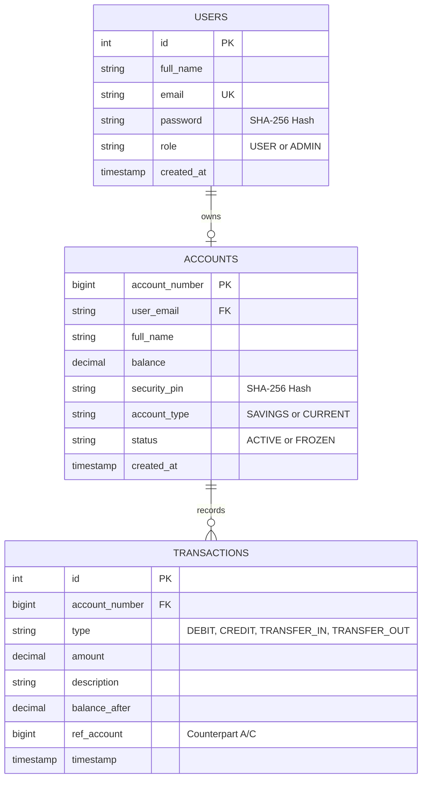

# 🏦 Apex Digital Banking System

[](https://www.oracle.com/java/)
[](https://www.mysql.com/)
[](https://docs.oracle.com/javase/tutorial/uiswing/)
[](https://en.wikipedia.org/wiki/SHA-2)
[](https://en.wikipedia.org/wiki/Data_access_object)

A full-featured, enterprise-grade Digital Banking Application built in Java adhering strictly to Object-Oriented Programming (OOP) paradigms, Layered Architecture (Model-DAO-UI-Util), and ACID Transaction Principles.

The application offers both an **interactive Java Swing Graphical User Interface (GUI)** with event handling as well as a modernized **Command-Line Interface (CLI)** sharing the exact same DAO layer and cryptographic security.

---

## 📑 Table of Contents
1. [Key Features](#-key-features)
2. [Project & Folder Structure](#-project--folder-structure)
3. [Database Schema](#-database-schema)
4. [OOP & Core Java Concepts](#-oop--core-java-concepts-demonstrated)
5. [Installation & Setup](#-installation--setup)
6. [Compilation & Execution](#-compilation--execution)
7. [Viva & Evaluation Guide](#-viva--evaluator-qa-guide)

---

## ✨ Key Features

### 👤 Customer Banking Portal
- **User Registration & Authentication**: Clean multi-field sign up with regex email validation and strong password requirements.
- **Cryptographic Security**: Passwords and 4-6 digit Security PINs are hashed using **SHA-256** before database storage; plaintext credentials are never persisted.
- **Account Opening**: Seamless self-service account generation with choice of account types (`SAVINGS` / `CURRENT`) and minimum initial deposit rules.
- **Protected Balance Toggle**: Available balance is masked (`₹ ••••••••`) by default; revealed only after PIN verification with a single-click hide toggle.
- **Debit / Cash Withdrawal**: Balance validation, active account verification, and automated transaction logging.
- **Credit / Cash Deposit**: Instant balance updates with atomic database commits.
- **Inter-Bank / P2P Fund Transfers**: Guaranteed atomic execution using JDBC manual commit and rollback (`connection.setAutoCommit(false)`), ensuring neither account loses funds in case of communication or system failure.
- **Mini-Statement**: Quick-view modal of the last 5 transactions.
- **Passbook & Transaction History**: Dedicated, color-coded `JTable` view (green for incoming credits, red for outgoing debits) with type filtering (All, Credits, Debits, Transfers).

### 🛡️ Administrative & Fraud Prevention Console
- **Default Admin Account**: Auto-seeded on startup (`admin@bank.com` / `Admin@123`).
- **Customer Account Management**: Real-time table of all accounts with search filtering by name, email, or account number.
- **Account Freeze / Unfreeze**: One-click fraud prevention to lock compromised accounts, disallowing all debit, credit, and transfer attempts until unfreezed.
- **Live System-Wide Audit Ledger**: Complete chronological feed of every transaction executed across all customer accounts.

---

## 🏛️ Project & Folder Structure

The repository follows standard Java conventions with clear segregation of sources, database scripts, and documentation:

```
Banking_System/
├── src/                                # Standard Java Source Root
│   ├── BankingGUI.java                 # Master Swing GUI Controller & Entry Point
│   ├── BankingApp.java                 # CLI Console Entry Point (Unified DAO Backend)
│   ├── model/                          # Encapsulated Data Transfer POJOs
│   │   ├── User.java                   # User entity (id, email, password hash, role)
│   │   ├── Account.java                # Bank account entity (number, balance, status)
│   │   └── Transaction.java            # Audit record (type, amount, balanceAfter)
│   ├── dao/                            # Data Access Layer (Direct JDBC & PreparedStatements)
│   │   ├── DBConnection.java           # Thread-safe Singleton Connection Manager
│   │   ├── UserDAO.java                # Authentication, Registration & Hash verification
│   │   ├── AccountDAO.java             # Balance mutation, transfers & freeze controls
│   │   └── TransactionDAO.java         # Transaction logging and history queries
│   ├── ui/                             # Presentation Tier (Java Swing + Event Handling)
│   │   ├── UITheme.java                # Modern color palette, typography & styled widgets
│   │   ├── LoginPanel.java             # Responsive authentication view
│   │   ├── RegisterPanel.java          # Client onboarding view
│   │   ├── DashboardPanel.java         # Account summary, balance toggle & actions grid
│   │   ├── TransactionPanel.java       # Filterable passbook table with custom renderer
│   │   └── AdminPanel.java             # Tabbed staff dashboard with freeze & audit tools
│   └── util/
│       └── PasswordUtil.java           # Cryptographic hashing (SHA-256) & input validation
├── sql/
│   └── banking_schema.sql              # Automated database DDL setup script
├── docs/
│   └── Screenshots/                    # Interface previews and demo captures
├── .gitignore                          # Build artifact and editor cache ignores
├── .gitattributes
└── README.md                           # Documentation & evaluation manual
```

---

## 🗄️ Database Schema

The database consists of three relational tables with Foreign Key constraints and automatic timestamps:



---

## 🧠 OOP & Core Java Concepts Demonstrated

| Concept | Implementation in Code |
| :--- | :--- |
| **Encapsulation** | All fields in `User`, `Account`, and `Transaction` are `private`, accessible only via validated getters and setters. |
| **Abstraction** | UI panels interact exclusively through high-level DAO interfaces (`accountDAO.transferMoney(...)`), completely abstracting SQL details, driver management, and connection mechanics. |
| **Singleton Pattern** | `DBConnection` utilizes a private constructor and synchronized static accessor to ensure a single managed connection pool instance. |
| **ACID Transactions** | `AccountDAO.transferMoney` manages explicit transactional integrity with `connection.setAutoCommit(false)`, committing only if both legs succeed and executing `connection.rollback()` upon any failure. |
| **Event Handling** | Comprehensive usage of `ActionListener`, `KeyAdapter` (Enter key submissions), `MouseListener` (hover cards), and `WindowAdapter` (orderly DB shutdown). |
| **GUI Framework** | Built with standard `javax.swing` components (`JFrame`, `JPanel`, `CardLayout`, `JTable`, `JTabbedPane`, `JPasswordField`, `JOptionPane`, `DefaultTableCellRenderer`). |
| **Exception Handling** | Robust try-with-resources and targeted SQL/Input exceptions avoiding silent crashes and providing descriptive user alerts. |

---

## 🚀 Installation & Setup

### Prerequisites
1. **Java JDK 21 or 22** installed and configured on your `PATH`.
2. **MySQL Server 8.0+** running locally on port `3306`.
3. **MySQL Connector/J JAR** (`mysql-connector-j-8.x.x.jar`).

### Database Initialization
Run the provided SQL script located in the `sql/` directory:
```bash
mysql -u root -p < sql/banking_schema.sql
```
*(Enter your MySQL password when prompted).*

### Database Credentials Configuration
If your MySQL credentials differ from the defaults (`root` / `knox`), adjust them in:
- `src/BankingGUI.java` (lines 35-37)
- `src/BankingApp.java` (lines 25-27)

---

## 💻 Compilation & Execution

Open a terminal in the root directory:

```bash
# 1. Compile the entire application cleanly into an isolated bin/ directory
javac -d bin src/model/*.java src/util/*.java src/dao/*.java src/ui/*.java src/*.java

# 2. Run the Graphical User Interface (Swing GUI)
java -cp "bin;path/to/mysql-connector-j-8.x.x.jar" Projects_java.Banking_System.BankingGUI

# 3. (Optional) Run the CLI Console Version
java -cp "bin;path/to/mysql-connector-j-8.x.x.jar" Projects_java.Banking_System.BankingApp
```

---

## 🎓 Viva & Evaluator Q&A Guide

### Q1: Why did you use `PreparedStatement` instead of `Statement`?
> **Answer:** `PreparedStatement` pre-compiles SQL queries on the database server, which improves execution efficiency for repeated calls. More critically, it prevents **SQL Injection** attacks by sanitizing and binding parameters as typed values rather than raw concatenated strings.

### Q2: How is transaction safety guaranteed during money transfer?
> **Answer:** We employ **ACID Transaction Management**. In `AccountDAO.transferMoney`, we set `connection.setAutoCommit(false)`. We execute both the debit query on the sender and the credit query on the receiver. If and only if both statements succeed without throwing exceptions, we issue `connection.commit()`. If an error occurs (such as invalid balance, network drops, or constraint violations), the `catch` block calls `connection.rollback()`, ensuring the bank's ledger remains consistent.

### Q3: How is password and PIN security handled?
> **Answer:** Rather than storing credentials in plain text, we utilize a one-way cryptographic hash algorithm (**SHA-256**) in `PasswordUtil.hash()`. Even if the database were compromised, the original passwords and PINs cannot be derived from the stored 64-character hexadecimal digests.

### Q4: Explain the architectural pattern used.
> **Answer:** We implemented a **Layered MVC/DAO Architecture**. The **Model** represents business entities (`User`, `Account`, `Transaction`), the **DAO Layer** handles all persistent CRUD operations via JDBC, the **UI Layer** handles view presentation and user event dispatching, and the **Util Layer** provides transversal cryptographic and validation routines.

---

### 👨‍💻 Project Evaluation Credentials
- **Customer Account**: Register a new user via the GUI or open an account with initial deposit.
- **Admin Portal Login**:
  - **Email**: `admin@bank.com`
  - **Password**: `Admin@123`
