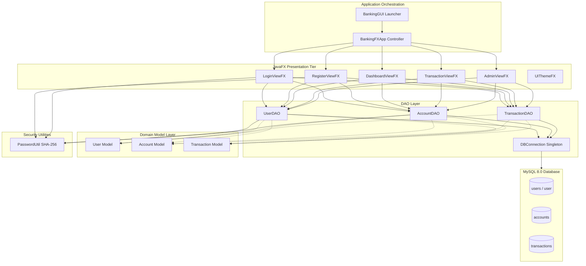
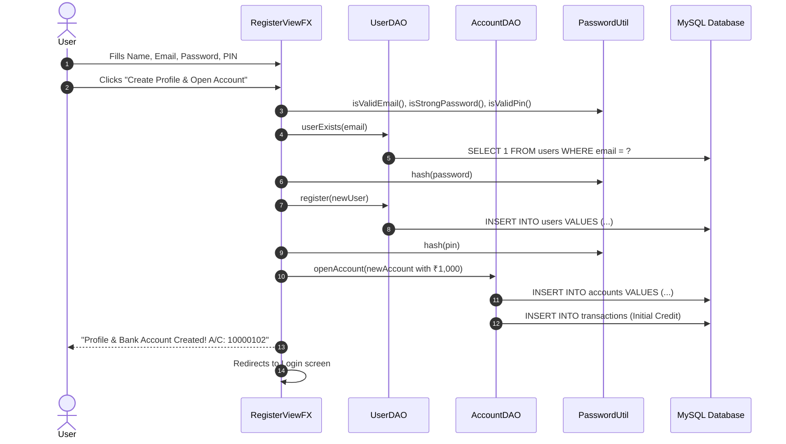
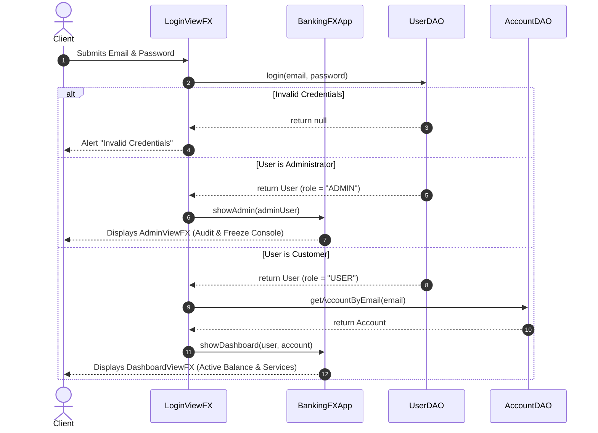
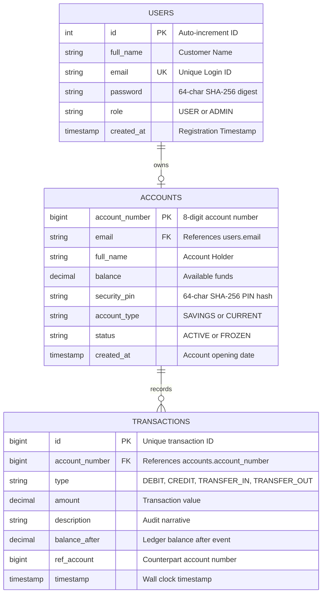

# 🏦 Apex Digital Banking System — Complete Architecture & Code Guide

## 📌 Table of Contents
1. [System Architecture Overview](#1-system-architecture-overview)
2. [Comprehensive Feature Catalog](#2-comprehensive-feature-catalog)
3. [File-by-File Code Breakdown](#3-file-by-file-code-breakdown)
   - [Entry Points & Launchers](#a-entry-points--launchers)
   - [Model Layer (POJOs)](#b-model-layer-pojos)
   - [Data Access Layer (DAO)](#c-data-access-layer-dao)
   - [Presentation Tier (JavaFX UI)](#d-presentation-tier-javafx-ui)
   - [Utility Layer](#e-utility-layer)
   - [Scripts & Schema](#f-scripts--database-schema)
4. [Critical Operations & Sequence Flows](#4-critical-operations--sequence-flows)
   - [Atomic Fund Transfer (ACID)](#atomic-fund-transfer-flow-acid)
   - [User Registration & Automatic Account Provisioning](#user-registration--account-provisioning-flow)
   - [Role-Based Authentication Routing](#role-based-authentication-routing)
5. [Database Relational Schema](#5-database-relational-schema)
6. [Viva & Evaluator Q&A Reference](#6-viva--evaluator-qa-reference)

---

## 1. System Architecture Overview

The **Apex Digital Banking System** is designed around enterprise **Layered Architecture (MVC / DAO)**. It completely separates business domain models, persistence/database mechanics, user presentation, and cryptographic security into isolated modules.



### Core Design Patterns Implemented:
1. **Model-View-Controller (MVC)**:
   - **Model**: `User.java`, `Account.java`, `Transaction.java`.
   - **View**: Pure JavaFX nodes in `src/ui/`.
   - **Controller**: `BankingFXApp.java` orchestrates view switching, stage management, and session state.
2. **Data Access Object (DAO)**:
   - Encapsulates all raw JDBC calls, SQL queries, and transaction boundaries away from the UI.
3. **Singleton Pattern**:
   - `DBConnection.java` enforces a single shared JDBC connection instance, preventing connection exhaustion and resource leaks.
4. **ACID Transaction Management**:
   - `AccountDAO.transferMoney` uses manual commit/rollback (`connection.setAutoCommit(false)`) across multiple tables.

---

## 2. Comprehensive Feature Catalog

The system implements **14 rich enterprise banking operations**:

### 👤 Customer Features
1. **User Registration with Instant Provisioning**:
   - Captures Full Name, Email, Password, and a 4-6 digit Security PIN.
   - Automatically registers the user profile and provisions a bank account with an initial ₹1,000 welcome credit in one atomic step.
2. **Secure Authentication**:
   - Validates email regex and SHA-256 hashed password.
   - Detects whether the user is a `USER` or `ADMIN` and routes accordingly.
3. **PIN-Protected Balance Masking**:
   - On the customer dashboard, the balance is masked (`₹ ••••••••`) by default to protect user privacy.
   - Clicking "👁 Show Balance" prompts for the user's 4-6 digit Security PIN in a modal dialog.
   - Toggles to "🙈 Hide Balance" on demand.
4. **Debit (Cash Withdrawal)**:
   - Requires PIN verification, validates account status (`ACTIVE` vs `FROZEN`), ensures sufficient funds, updates the balance, and logs the debit transaction.
5. **Credit (Cash Deposit)**:
   - Requires PIN verification, deposits funds, updates account balance, and logs a credit transaction.
6. **Inter-Bank / P2P Fund Transfer (NEFT/IMPS)**:
   - Checks sender PIN and account status.
   - Validates receiver account existence.
   - Debits sender and credits receiver in an atomic JDBC transaction.
7. **Mini-Statement Dialog**:
   - Prompts for PIN and displays the last 5 transactions in a compact JavaFX `TableView`.
8. **Interactive Passbook & Transaction Ledger**:
   - Color-coded `TableView` (Green for credits/deposits, Red for debits/transfers).
   - Dropdown filter: `ALL TRANSACTIONS`, `CREDIT ONLY`, `DEBIT ONLY`, `TRANSFERS ONLY`.
   - Dynamic transaction counter.
9. **Account Profile Inspection**:
   - Modal displaying account holder name, account number, email, account type (`SAVINGS`/`CURRENT`), status, and timestamp.
10. **Fallback Account Creation**:
    - For users who sign up via legacy CLI or external scripts without an initial account, the dashboard displays a "No Bank Account Found" screen with a 1-click account opening flow.

### 🛡️ Administrative & Fraud Prevention Features
11. **Default Administrator Auto-Seeding**:
    - If no admin exists on boot, the system auto-creates `admin@bank.com` / `Admin@123` with role `ADMIN`.
12. **Customer Account Management Console**:
    - Live `TableView` displaying all registered accounts in the bank.
    - Dynamic text search filtering instantly across Account Number, Holder Name, and Email.
13. **One-Click Fraud Lock (Freeze / Unfreeze)**:
    - Admin can select any suspicious account and click "❄ Freeze Account".
    - Once frozen, all debit, credit, and transfer attempts are blocked at the database validation layer.
    - Status can be restored via "✔ Unfreeze Account".
14. **System-Wide Audit Ledger**:
    - Dedicated tab streaming the latest 200 transactions across the entire institution with timestamps, amounts, balances, and counterpart account references.

---

## 3. File-by-File Code Breakdown

### A. Entry Points & Launchers

#### 1. `BankingGUI.java` (14 lines)
* **Path**: `src/BankingGUI.java`
* **Purpose**: Universal bootstrap launcher class for the JavaFX GUI.
* **Why it exists**: In standard Java 11+, running an `Application` subclass directly without the Java module system can trigger `"JavaFX runtime components are missing"`. Having a standard non-Application class call `Application.launch(BankingFXApp.class, args)` bypasses this limitation, allowing execution from IDEs, batch files, and CLI commands.

#### 2. `BankingFXApp.java` (155 lines)
* **Path**: `src/BankingFXApp.java`
* **Purpose**: Primary JavaFX `Application` controller managing views, database lifecycle, and stage navigation.
* **Key Fields**:
  - `primaryStage`, `rootPane`, `Scene`: Primary window layout containers.
  - `connection`, `userDAO`, `accountDAO`, `transactionDAO`: Shared persistence instances.
  - `loginView`, `registerView`, `dashboardView`, `transactionView`, `adminView`: View panel references.
  - `currentLoggedInUser`, `currentLoggedInAccount`: Active session state.
* **Key Methods**:
  - `start(Stage stage)`: Initializes DB, creates root container, attaches window close confirmation listener, and displays login.
  - `initDatabase()`: Calls `DBConnection.getConnection()`, initializes all DAO objects.
  - `showLogin()`, `showRegister()`: Switches root view to authentication cards.
  - `showDashboard(User user, Account account)`: Updates session state and displays customer dashboard.
  - `showDashboardAfterTx()`: **Intelligent Back Router** — routes `ADMIN` back to `adminView` and `USER` back to `dashboardView`.
  - `showTransactions(Account account)`: Passes the account and current viewer role to the passbook view.
  - `showAdmin(User admin)`: Loads the administrative tabbed console.

#### 3. `BankingApp.java` (344 lines)
* **Path**: `src/BankingApp.java`
* **Purpose**: Command-Line Interface (CLI) alternative to the GUI.
* **Key Feature**: Completely modernized to share the exact same `UserDAO`, `AccountDAO`, `TransactionDAO`, and `PasswordUtil` cryptographic hashing as the GUI. Allows complete banking operations from terminal consoles.

---

### B. Model Layer (POJOs)

#### 4. `User.java` (58 lines)
* **Path**: `src/model/User.java`
* **Purpose**: Plain Old Java Object (POJO) modeling a customer or staff user.
* **Fields**: `int id`, `String fullName`, `String email`, `String password` (SHA-256 hash), `String role` (`USER` or `ADMIN`), `Timestamp createdAt`.
* **OOP Principle**: **Encapsulation** — all fields are `private` with public getter/setter methods.

#### 5. `Account.java` (80 lines)
* **Path**: `src/model/Account.java`
* **Purpose**: Domain model representing a financial bank account.
* **Fields**: `long accountNumber`, `String userEmail`, `String fullName`, `double balance`, `String securityPin` (hashed), `String accountType` (`SAVINGS`/`CURRENT`), `String status` (`ACTIVE`/`FROZEN`), `Timestamp createdAt`.
* **Key Helper**: `isActive()` returns `true` if status equals `"ACTIVE"`.

#### 6. `Transaction.java` (66 lines)
* **Path**: `src/model/Transaction.java`
* **Purpose**: Immutable audit entity representing a ledger operation.
* **Fields**: `long id`, `long accountNumber`, `String type` (`DEBIT`, `CREDIT`, `TRANSFER_IN`, `TRANSFER_OUT`), `double amount`, `String description`, `double balanceAfter`, `Long refAccount` (counterpart account for transfers), `Timestamp timestamp`.

---

### C. Data Access Layer (DAO)

#### 7. `DBConnection.java` (59 lines)
* **Path**: `src/dao/DBConnection.java`
* **Purpose**: Thread-safe **Singleton** JDBC connection manager.
* **Design Pattern**: **Singleton** — private constructor prevents external instantiation (`new DBConnection()`).
* **Key Methods**:
  - `getConnection(url, user, password)`: Loads `com.mysql.cj.jdbc.Driver` and creates a single persistent connection, reusing it across subsequent calls.
  - `closeConnection()`: Safely closes the socket connection on application exit.

#### 8. `UserDAO.java` (147 lines)
* **Path**: `src/dao/UserDAO.java`
* **Purpose**: Persistence operations for user authentication and onboarding.
* **Key Methods**:
  - `UserDAO(connection)`: Constructor; calls `ensureSchemaCompatibility()` and `createDefaultAdminIfNotExists()`.
  - `register(User user)`: Checks if user exists; hashes password via `PasswordUtil.hash()` and inserts into `users`.
  - `login(email, plainPassword)`: Retrieves stored hash. Uses `PasswordUtil.verify()` to validate. If matching a legacy plaintext password, automatically transparently updates it to SHA-256 (`upgradePasswordHash`).
  - `userExists(email)`: Checks for email duplication.
  - `getAllUsers()`: Returns list of all registered users for staff auditing.
  - `createDefaultAdminIfNotExists()`: Auto-provisions `admin@bank.com` if absent.

#### 9. `AccountDAO.java` (437 lines)
* **Path**: `src/dao/AccountDAO.java`
* **Purpose**: Core banking business logic and database mutations.
* **Key Methods**:
  - `ensureSchemaCompatibility()`: Auto-alters `security_pin` to `VARCHAR(64)` on startup to prevent data truncation.
  - `openAccount(Account account)`: Generates a unique 8-digit account number starting at `10000100`, hashes PIN with SHA-256, inserts account record, and logs the opening credit transaction.
  - `verifyPin(accountNumber, plainPin)`: Validates PIN using `PasswordUtil.verify()`. Transparently upgrades legacy plaintext PINs to SHA-256 hashes on successful verification.
  - `debitMoney(accountNumber, amount, plainPin)`: Validates PIN, checks account `ACTIVE` status, verifies sufficient balance, executes `UPDATE accounts SET balance = balance - ?`, logs `DEBIT` transaction, and commits.
  - `creditMoney(accountNumber, amount, plainPin)`: Validates PIN and active status, adds funds, logs `CREDIT` transaction, and commits.
  - `transferMoney(senderAcc, receiverAcc, amount, plainPin)`: **ACID Transaction**. Disables auto-commit (`setAutoCommit(false)`). Debits sender, credits receiver, logs `TRANSFER_OUT` and `TRANSFER_IN` audit records, and executes `connection.commit()`. If any step fails, calls `connection.rollback()`.
  - `freezeAccount(accountNumber)`: Sets status to `'FROZEN'`.
  - `unfreezeAccount(accountNumber)`: Sets status to `'ACTIVE'`.
  - `getAllAccounts()`: Retrieves all accounts for the admin dashboard.

#### 10. `TransactionDAO.java` (98 lines)
* **Path**: `src/dao/TransactionDAO.java`
* **Purpose**: Ledger insertion and history queries.
* **Key Methods**:
  - `logTransaction(Transaction tx)`: Inserts audit record with timestamp, balance after, and counterpart account.
  - `getHistory(accountNumber, limit)`: Returns recent transactions for passbook / mini-statement ordered by timestamp descending.
  - `getAllTransactions(limit)`: Returns institution-wide transaction feed for the administrative audit tab.

---

### D. Presentation Tier (JavaFX UI)

#### 11. `UIThemeFX.java` (124 lines)
* **Path**: `src/ui/UIThemeFX.java`
* **Purpose**: Centralized design system and UI helper factory.
* **Colors**: `#0D47A1` (Primary Blue), `#2E7D32` (Forest Green), `#C62828` (Crimson Danger), `#EF6C00` (Amber Warning), `#F5F7FA` (Cloud Gray).
* **Key Helpers**:
  - `createHeader(title, subtitle)`: Styled top banner.
  - `createButton(text, bgHex, hoverHex)`: Button with rounded corners and hover mouse handlers.
  - `createTextField(prompt)`, `createPasswordField(prompt)`: Form inputs with padding and borders.
  - `showAlert(type, title, header, content)`: Standardized JavaFX alert popup.
  - `promptPinDialog(title, message)`: Reusable modal dialog with masked `PasswordField` returning `Optional<String>`.

#### 12. `LoginViewFX.java` (166 lines)
* **Path**: `src/ui/LoginViewFX.java`
* **Purpose**: JavaFX authentication view.
* **Components**: Card layout with shadow effect, Email field, Password field, Sign In button, Register link, demo credentials hint.
* **Event Handling**: Action handler on button, `KeyCode.ENTER` key listener on password field to submit instantly. Routes `ADMIN` users to Admin Console and `USER` customers to Customer Dashboard.

#### 13. `RegisterViewFX.java` (200 lines)
* **Path**: `src/ui/RegisterViewFX.java`
* **Purpose**: Customer onboarding and account provisioning view.
* **Components**: Full Name, Email, Password, Confirm Password, Security PIN fields.
* **Key Logic**: Validates regex email, password strength ($\ge$ 8 chars), password confirmation match, and 4-6 digit numeric PIN format. On submit, registers the user in `users` and immediately provisions an active `accounts` record with ₹1,000 welcome credit, eliminating two-step registration friction.

#### 14. `DashboardViewFX.java` (635 lines)
* **Path**: `src/ui/DashboardViewFX.java`
* **Purpose**: Main customer operational dashboard.
* **Layout**:
  - Top navigation bar with greeting, refresh button, and logout.
  - Summary Card: Account number, type, status badge (`ACTIVE`/`FROZEN`), masked balance card with "Show Balance" PIN toggle.
  - Services Grid: 6 action buttons for Debit, Credit, Transfer, Mini-Statement, Passbook, and Account Profile.
  - Fallback View: "No Bank Account Found" screen for legacy accounts with a 1-click opening dialog.
* **Event Handling**: Modal dialogs for PIN and amount inputs, input parsing, error catching, and instant view refreshing.

#### 15. `TransactionViewFX.java` (210 lines)
* **Path**: `src/ui/TransactionViewFX.java`
* **Purpose**: Dedicated passbook and transaction history view.
* **Components**:
  - Top bar with dynamic role-aware Back Button (**"← Back to Admin Console"** for Admin, **"← Back to Dashboard"** for Customers).
  - Filter Toolbar: Dropdown combo box filtering by `ALL`, `CREDIT ONLY`, `DEBIT ONLY`, `TRANSFERS ONLY`, refresh button, and item counter.
  - `TableView<Transaction>`: Displays ID, Date/Time, Type, Amount, Description, Balance After, Counterpart A/C.
  - Custom `TableCell` factory: Color-codes Type column (Bold Green for credits, Bold Red for debits).

#### 16. `AdminViewFX.java` (329 lines)
* **Path**: `src/ui/AdminViewFX.java`
* **Purpose**: Administrative oversight, fraud prevention, and audit console.
* **Layout**:
  - Header with Dark Slate styling, Refresh All button, and Admin Logout.
  - `TabPane` with 2 tabs:
    - **Tab 1: Customer Accounts Management**: Live search field with real-time `ChangeListener` on text property; "Freeze Account" and "Unfreeze Account" buttons; "View Account Ledger" button; `TableView<Account>` with red highlight on frozen accounts.
    - **Tab 2: System-wide Transaction Audit**: `TableView<Transaction>` displaying institution-wide chronological transaction stream.

---

### E. Utility Layer

#### 17. `PasswordUtil.java` (70 lines)
* **Path**: `src/util/PasswordUtil.java`
* **Purpose**: Centralized cryptographic hashing and input format validation.
* **Key Methods**:
  - `hash(plainText)`: Computes one-way cryptographic **SHA-256** digest and formats it as a 64-character hexadecimal string.
  - `verify(plainText, expectedHash)`: Re-hashes input and verifies against stored digest using `MessageDigest.isEqual()` to prevent timing attacks.
  - `isValidEmail(email)`: Regex pattern matching standard email formats (`^[A-Za-z0-9+_.-]+@(.+)$`).
  - `isStrongPassword(password)`: Enforces minimum 8 characters.
  - `isValidPin(pin)`: Enforces 4 to 6 numeric digits (`^\\d{4,6}$`).

---

### F. Scripts & Database Schema

#### 18. `banking_schema.sql` (64 lines)
* **Path**: `sql/banking_schema.sql`
* **Purpose**: Complete DDL relational schema for MySQL 8.0+.
* **Defines**:
  - `users` table: `id`, `full_name`, `email` (UK), `password` (SHA-256), `role`, `created_at`.
  - `accounts` table: `account_number` (PK), `email` (FK), `full_name`, `balance`, `security_pin` (`VARCHAR(64)`), `account_type`, `status`, `created_at`.
  - `transactions` table: `id` (PK AUTO_INCREMENT), `account_number` (FK), `type`, `amount`, `description`, `balance_after`, `ref_account`, `timestamp`.

#### 19. `run-gui.bat` (24 lines)
* **Path**: `run-gui.bat`
* **Purpose**: One-click Windows batch script.
* **Action**: Automatically compiles all Java files into `bin/` using bundled `javafx-sdk\lib` module path and launches `BankingGUI`.

#### 20. `run-cli.bat` (23 lines)
* **Path**: `run-cli.bat`
* **Purpose**: One-click launcher for the terminal console interface.

---

## 4. Critical Operations & Sequence Flows

### Atomic Fund Transfer Flow (ACID)
```mermaid
sequenceDiagram
    autonumber
    actor Customer
    participant Dash as DashboardViewFX
    participant DAO as AccountDAO
    participant TxDAO as TransactionDAO
    participant DB as MySQL Database

    Customer->>Dash: Clicks "Transfer Funds"
    Dash->>Customer: Prompts Receiver A/C, Amount, PIN
    Customer->>Dash: Submits (A/C: 10000101, ₹500, PIN: 1234)
    Dash->>DAO: transferMoney(10000100, 10000101, 500, "1234")
    DAO->>DAO: verifyPin(10000100, "1234")
    DAO->>DB: setAutoCommit(false)
    Note over DAO,DB: Transaction Begins
    DAO->>DB: UPDATE accounts SET balance = balance - 500 WHERE account_number = 10000100
    DAO->>DB: UPDATE accounts SET balance = balance + 500 WHERE account_number = 10000101
    DAO->>TxDAO: logTransaction(TRANSFER_OUT for Sender)
    DAO->>TxDAO: logTransaction(TRANSFER_IN for Receiver)
    alt All operations succeed
        DAO->>DB: connection.commit()
        Note over DAO,DB: Changes permanently persisted
        DAO-->>Dash: return true
        Dash-->>Customer: "Transfer Complete! ₹500 sent."
    else Any exception occurs
        DAO->>DB: connection.rollback()
        Note over DAO,DB: All changes undone; zero funds lost
        DAO-->>Dash: throw Exception
        Dash-->>Customer: Alert: "Transfer Failed: Error message"
    end
```

---

### User Registration & Account Provisioning Flow



---

### Role-Based Authentication Routing



---

## 5. Database Relational Schema



---

## 6. Viva & Evaluator Q&A Reference

### Q1: What makes this project meet the "Outstanding" rubric tier?
> **Answer:** The rubric requires:
> 1. **Event Handling**: Implemented using JavaFX `ActionEvent`, `KeyEvent` (Enter to submit), `ChangeListener` (live search filtering), and window close event handlers.
> 2. **JavaFX**: Pure modern JavaFX 22 presentation tier using `Stage`, `Scene`, `BorderPane`, `TableView`, `TabPane`, `Alert`, and `Dialog`.
> 3. **MySQL with Rich Operations**: 14 rich banking features including PIN-protected balance masking, ACID inter-account transfers, one-click fraud freezing/unfreezing, live transaction filtering, and institution-wide audit ledgers.

### Q2: Why did you use `PreparedStatement` instead of `Statement`?
> **Answer:** `PreparedStatement` offers two crucial advantages:
> 1. **Security**: It completely immunizes the application against **SQL Injection** by binding parameters as typed variables rather than concatenating user input strings.
> 2. **Performance**: The SQL statement template is pre-compiled on the database engine once and re-executed with new parameters, reducing query parsing overhead.

### Q3: How do you handle transaction safety during money transfers?
> **Answer:** We use **ACID Transaction Management** via JDBC. In `AccountDAO.transferMoney`, we call `connection.setAutoCommit(false)`. We execute the debit on the sender and the credit on the receiver. Only if both succeed without error do we call `connection.commit()`. If an exception occurs (e.g. invalid balance, connection drop, constraint error), the `catch` block invokes `connection.rollback()`, ensuring neither party loses money.

### Q4: Why is SHA-256 used instead of storing passwords in plain text?
> **Answer:** Passwords and Security PINs are processed through **SHA-256** one-way cryptographic hashing via `MessageDigest` in `PasswordUtil.hash()`. The database only stores irreversible 64-character hexadecimal digests. Even if the database is exposed, original passwords cannot be reversed.

### Q5: Explain the Singleton pattern used in the project.
> **Answer:** `DBConnection.java` implements the **Singleton Pattern**. Its private constructor prevents instantiation from outside. The static `getConnection()` method ensures only a single connection instance is created and shared across the entire application lifecycle, preventing socket leaks and excessive connection overhead.
